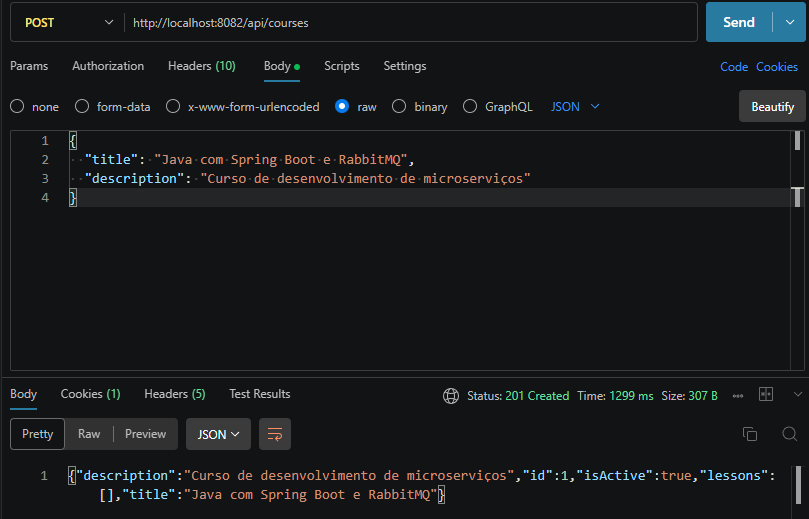
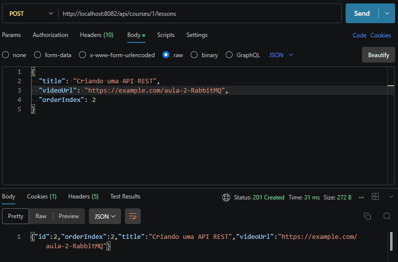
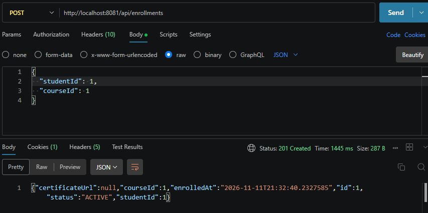
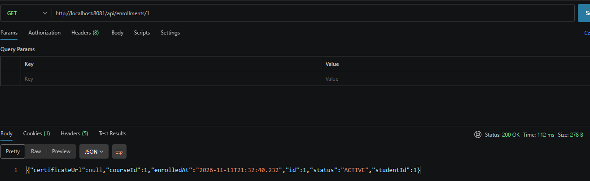
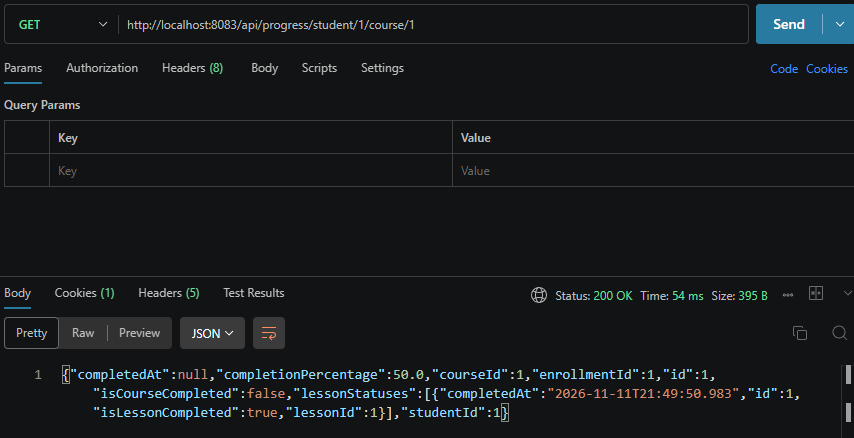
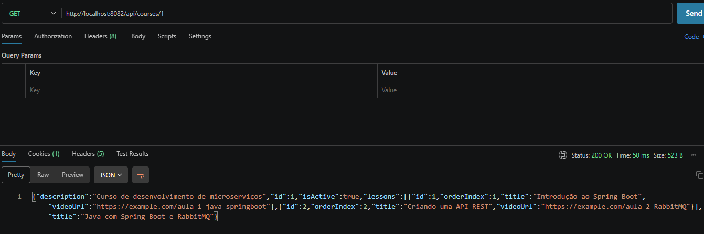
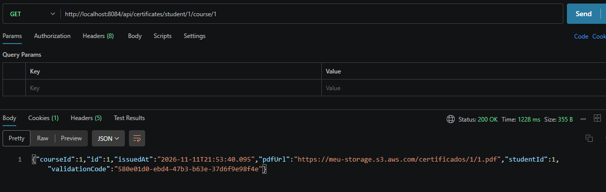

# Galeria de imagens

[Início](./Readme.md) · [Bancos de dados](./BANCOS_DE_DADOS.md) · [Decisões de arquitetura](./DECISOES_ARQUITETURA.md) · [Teste do fluxo](./TESTE_FLUXO_COMPLETO.md)

Esta galeria reúne as capturas de tela disponíveis na pasta `Docs`, mostrando algumas etapas de uso do sistema.

## Criação de curso

## Criação de lições

### Lição 1

### Lição 2

## Matrícula

### Criando matrícula

### Consultando matrícula

## Curso e progresso

### Progresso após concluir a primeira aula

### Consulta do curso e suas aulas

## Finalizado Segundo Curso hora do Certificado

