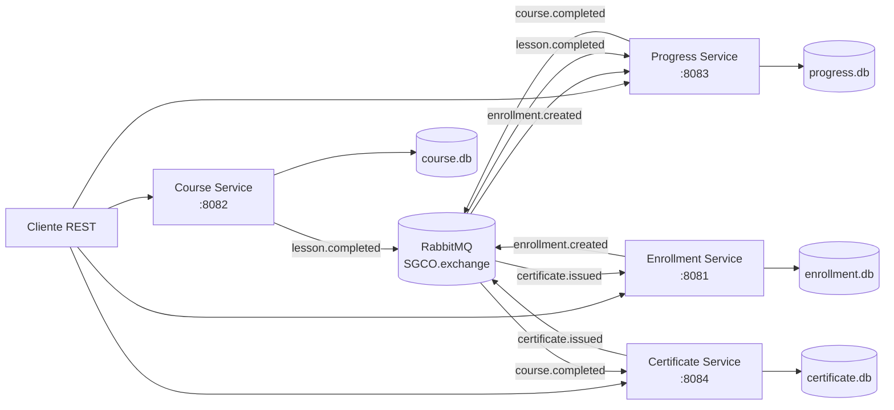
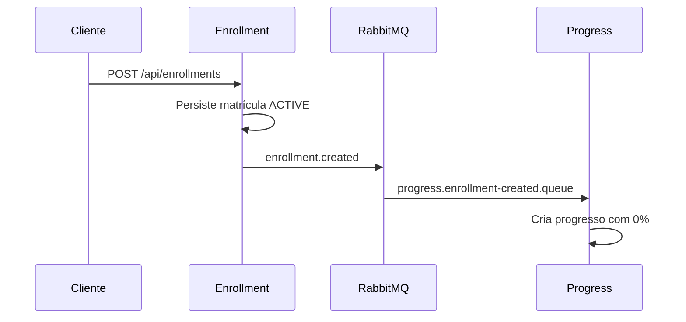
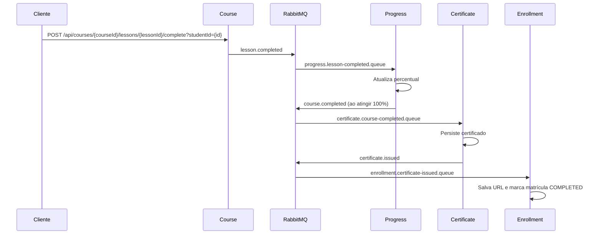

# SGCO - Sistema de Gestão de Cursos

Sistema distribuído para gerenciamento de cursos, matrículas, progresso de alunos e emissão de certificados.

## Integrante

- Victor Caetano Da Conceição

Trabalho desenvolvido individualmente.

## Documentação

- [Bancos de dados](./BANCOS_DE_DADOS.md)
- [Decisões de arquitetura](./DECISOES_ARQUITETURA.md)
- [Roteiro de teste do fluxo completo](./TESTE_FLUXO_COMPLETO.md)
- [Galeria de imagens](./GALERIA_DE_IMAGENS.md)

## Arquitetura

O projeto é organizado como quatro microserviços independentes. Cada serviço possui seu próprio banco SQLite e expõe uma API REST. A comunicação entre processos é feita de forma assíncrona pelo RabbitMQ; não há compartilhamento direto de tabelas entre os serviços.



### Responsabilidade dos serviços

| Serviço | Porta | Responsabilidade | Persistência |
| --- | ---: | --- | --- |
| `enrollment` | `8081` | Criar e consultar matrículas; atualizar a matrícula quando o certificado estiver pronto | `enrollment.db` |
| `course` | `8082` | Criar/consultar cursos e lições; publicar conclusão de lição | `course.db` |
| `progress` | `8083` | Inicializar e atualizar o progresso do aluno; detectar conclusão do curso | `progress.db` |
| `certificate` | `8084` | Registrar e consultar certificados; validar o código público | `certificate.db` |

Todos os serviços usam Spring Boot `4.1.0`, Java `21`, Spring Web MVC, Spring Data JPA, Hibernate e Lombok. Os eventos são enviados como JSON pelo exchange `SGCO.exchange`, do tipo `DirectExchange`.

**Limitações atuais:** há apenas um tipo de exchange configurado; portanto, o requisito de usar pelo menos dois tipos ainda não está atendido. Os logs e o tratamento de erros também são básicos, sem padronização centralizada.

### Fluxos de eventos

#### Matrícula e inicialização do progresso



#### Conclusão de curso e certificado



Os consumidores são idempotentes para tolerar reentrega de mensagens do RabbitMQ. O certificado atualmente usa uma URL demonstrativa de storage; a geração real do PDF e o armazenamento externo ainda devem ser integrados para produção.

## Pré-requisitos

- Java `21` configurado no `PATH` (`java -version`)
- Docker Desktop com Compose habilitado
- Git, caso o projeto ainda não esteja clonado

O Maven não precisa ser instalado: cada serviço contém `mvnw.cmd` para Windows e `mvnw` para Linux/macOS.

## Guia de execução

### 1. Iniciar a infraestrutura

Na raiz do projeto:

```bash
docker compose up -d
```

Esse comando inicia o RabbitMQ com AMQP em `localhost:5672` e o painel de administração em http://localhost:15672. Use `admin` / `admin123` para acessar o painel.

O Compose fornece o RabbitMQ. Os quatro serviços são executados localmente para manter as configurações atuais, que apontam para `localhost`.

### 2. Compilar e testar

Em cada diretório de serviço, execute os comandos abaixo. No Windows use `mvnw.cmd`; no Linux/macOS use `./mvnw`.

```powershell
cd enrollment
./mvnw.cmd clean test
cd ..\course
./mvnw.cmd clean test
cd ..\progress
./mvnw.cmd clean test
cd ..\certificate
./mvnw.cmd clean test
cd ..
```

### 3. Iniciar os serviços

Abra quatro terminais, sempre a partir da raiz do repositório:

```powershell
.\enrollment\mvnw.cmd -f enrollment\pom.xml spring-boot:run
```

```powershell
.\course\mvnw.cmd -f course\pom.xml spring-boot:run
```

```powershell
.\progress\mvnw.cmd -f progress\pom.xml spring-boot:run
```

```powershell
.\certificate\mvnw.cmd -f certificate\pom.xml spring-boot:run
```

Inicie primeiro o RabbitMQ, depois os serviços. A ordem entre os quatro serviços não é obrigatória: as filas duráveis são declaradas quando os consumidores se conectam.

### 4. Parar a execução

Interrompa cada processo com `Ctrl+C` e remova a infraestrutura quando necessário:

```bash
docker compose down
```

Para apagar também as mensagens e configurações persistidas do RabbitMQ:

```bash
docker compose down -v
```

## Endpoints principais

| Método | Endpoint | Serviço |
| --- | --- | --- |
| `POST` | `/api/courses` | Criar curso |
| `POST` | `/api/courses/{courseId}/lessons` | Criar lição |
| `GET` | `/api/courses/{courseId}` | Consultar curso e lições |
| `POST` | `/api/enrollments` | Criar matrícula |
| `GET` | `/api/enrollments/{enrollmentId}` | Consultar matrícula |
| `POST` | `/api/courses/{courseId}/lessons/{lessonId}/complete?studentId={studentId}` | Concluir lição |
| `GET` | `/api/progress/student/{studentId}/course/{courseId}` | Consultar progresso |
| `GET` | `/api/certificates/student/{studentId}/course/{courseId}` | Consultar certificado |
| `GET` | `/api/certificates/validate/{validationCode}` | Validar certificado |

### Exemplo rápido com PowerShell

```powershell
$course = Invoke-RestMethod -Method Post -Uri http://localhost:8082/api/courses -ContentType 'application/json' -Body '{"title":"Java com Spring","description":"Curso introdutório"}'
$enrollment = Invoke-RestMethod -Method Post -Uri http://localhost:8081/api/enrollments -ContentType 'application/json' -Body (ConvertTo-Json @{ studentId = 1; courseId = $course.id })
$lesson = Invoke-RestMethod -Method Post -Uri "http://localhost:8082/api/courses/$($course.id)/lessons" -ContentType 'application/json' -Body '{"title":"Primeira aula","videoUrl":"https://example.com/aula","orderIndex":1}'
Invoke-RestMethod -Method Post -Uri "http://localhost:8082/api/courses/$($course.id)/lessons/$($lesson.id)/complete?studentId=1"
```

Após o processamento assíncrono, consulte o progresso em `http://localhost:8083/api/progress/student/1/course/{courseId}`. Para um curso com todas as lições concluídas, o certificado estará disponível no serviço `certificate` e a matrícula será marcada como `COMPLETED`.

## Estrutura do repositório

```text
enrollment/   API de matrículas e consumidor de certificate.issued
course/       API de cursos/lições e produtor de lesson.completed
progress/     API de progresso e produtor de course.completed
certificate/  API de certificados e consumidor de course.completed
SGCO.drawio   Diagrama editável da solução
```

## Troubleshooting

- **Falha de conexão com RabbitMQ:** confirme `docker compose ps` e aguarde o container ficar disponível antes de iniciar os serviços.
- **Porta ocupada:** encerre o processo que usa `8081` a `8084` ou altere `server.port` no `application.properties` do serviço correspondente.
- **Dados inconsistentes durante testes:** pare os serviços e remova o arquivo `.db` do serviço desejado para recriar o SQLite na próxima execução.
- **Eventos não processados:** abra o painel em http://localhost:15672 e verifique as filas `progress.*`, `certificate.*` e `enrollment.*`.
